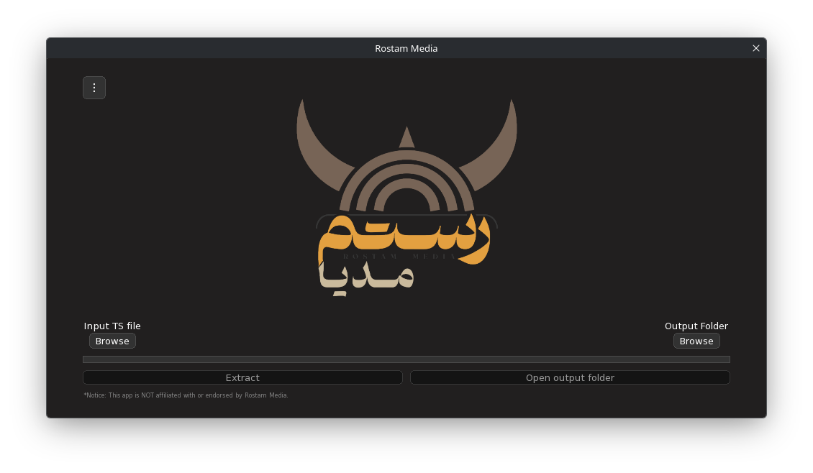

</img>

[فارسی](README_PER.md)

## Unofficial Rostam Media client.

Rostam Media is a way of downloading content like files and videos from satelite TVs. It provides a one-way Internet by integrating data inside ts packets. For extracring the data, you need to record the TV channel in *.ts format and extract from the ts file using the extractor software on your computer. The official Rostam Media's client (EQSat GUI) is only available on Windows 10+ (According to their support). So I made this client for other platforms in C++.

This client can run on Linux (Almost all distros including musl-based ones) and Windows 7+.

## Motivation

In Iran, the Internet usually gets disrupted in critical satuations... At those times the only way to access to free flow of information is satelite TVs, censorship-resistant VPNs(Usually is sold with high prices), and some other ways. Rostam Media is a satelite TV channel that puts files inside ts packets and sends them via YahSat satelite transmitter.
Their client for extracting is not compatible with all variants of Linux distros and they don't support older Windows versions so I made a client myself. 
I personally don't like the content they send but its better than nothing when the Internet is shutdown.

## Screenshot

## Installing

### 🐧 Linux
You can download the AppImage from the [releases](https://github.com/Ma5t3rful/rostam-media/releases/) page. Make it executable and run it. You can use integration tools for AppImage format to install it as well.

### 🪟 Windows
You can download the setup file from the [releases](https://github.com/Ma5t3rful/rostam-media/releases/) page and simply install it. The client can run on Windows 7 and up.

## NOTICE
#### This app is unofficial. This software is NOT affiliated with or endorsed by Rostam Media.

Made with love. 

`☕🧑‍💻🍕`
